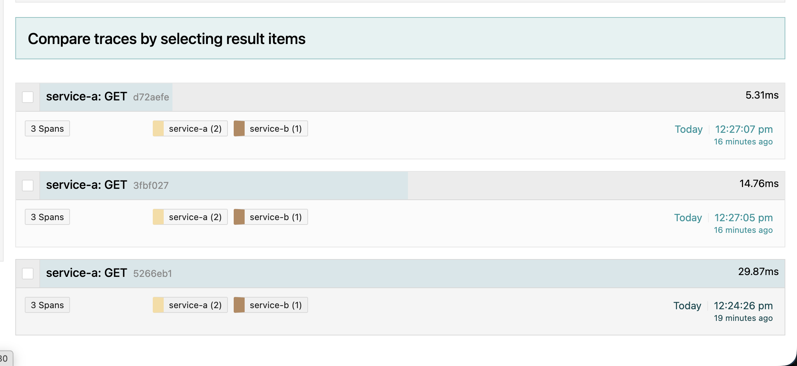
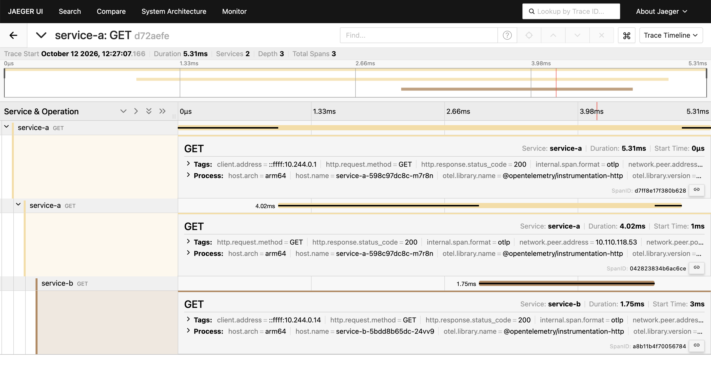
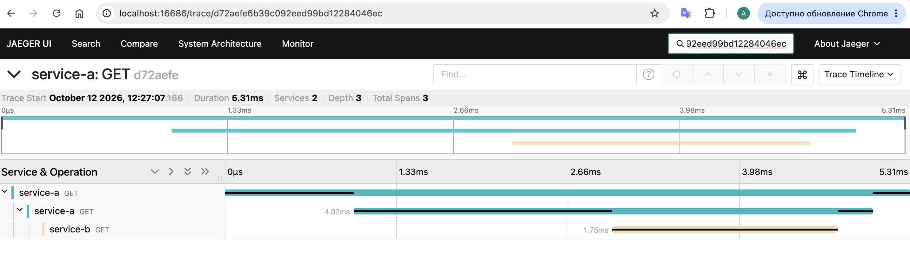

## Запуск
```bash
minikube start -p alexandrite --addons=ingress --memory=4096 --cpus=4
kubectl apply -f https://github.com/cert-manager/cert-manager/releases/download/v1.13.3/cert-manager.yaml
kubectl create namespace observability
kubectl create -f https://github.com/jaegertracing/jaeger-operator/releases/download/v1.51.0/jaeger-operator.yaml -n observability
kubectl set image deployment/jaeger-operator -n observability kube-rbac-proxy=quay.io/brancz/kube-rbac-proxy:v0.13.1
kubectl apply -f Task3/jaeger-instance.yaml
minikube image build -p alexandrite -t service-a:latest Task3/services/service-a/
minikube image build -p alexandrite -t service-b:latest Task3/services/service-b/
kubectl apply -f Task3/services.yaml
```

## Проверить (пример)
```bash
kubectl exec -it $(kubectl get pods -l app=service-a -o jsonpath='{.items[0].metadata.name}') -- wget -qO- http://service-a:8080
kubectl logs deploy/service-b   # тут видно traceparent от service-a
kubectl port-forward svc/simplest-query 16686:16686
```



