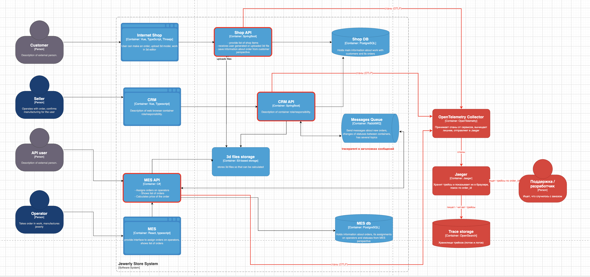

# Архитектурное решение по трейсингу

## Где заказ может сломаться или зависнуть

- **Магазин -> CRM.** CRM опрашивает Shop DB. Миграция в Shop DB или сбой опроса — CRM не видит заказ, он висит в SUBMITTED
- **Расчет цены в MES.** Идет до 30 минут. Оборвался при деплое — заказ висит, никто не знает. Упал на битом файле — статуса ошибки нет
- **API партнеров.** Таймаут -> повтор -> дубль. Партнер не знает, создан ли заказ
- **MES -> CRM через RabbitMQ.** Потерялось сообщение о расчете — заказа нет в CRM, продавцу нечего подтверждать
- **CRM -> MES через RabbitMQ.** Потерялось подтверждение — оператор не видит заказ, покупатель ждет месяцами

## Данные в трейсинге

Стандартные поля спана: trace id, span id, родительский спан, сервис, операция, начало и длительность, статус (успех / ошибка), текст ошибки

Поля:
- `order_id` — главный, по нему находим все трейсы заказа за все дни
- `order.status` — статус до и после шага
- `source` — магазин / партнер, `partner_id` — для заказов через API
- `complexity` и точное число полигонов — для расчета цены
- `queue` — для сообщений через RabbitMQ

## Мотивация

Сейчас история заказа разбросана по 3м системам и очередям — целиком путь заказа не видит никто. Когда заказ теряется, разработчик часто закрывает баг с ответом "не хватает логов". Трейсинг собирает путь заказа в одну картину: видно, где заказ сейчас и на каком шаге сломался.

На что повлияет:
- **Время разбора инцидента (MTTR)** — Вместо "не хватает логов" сразу видно шаг, где сломалось
- **Время обнаружения зависшего заказа** — Сейчас недели, до жалобы клиента
- **Количество жалоб на потерянные и просроченные заказы** — бизнес
- **Доля заказов, выполненных в обещанный срок (три недели)** — бизнес

## Предлагаемое решение
- **OpenTelemetry SDK** в Shop API, CRM API, MES API
- **Передача контекста**: trace id едет в заголовке `traceparent` — в HTTP-запросах и в заголовках сообщений RabbitMQ. Отправитель кладет, получатель достает и продолжает тот же трейс
- **OpenTelemetry Collector** — принимает спаны от всех сервисов, вычищает лишнее, отправляет в Jaeger
- **Jaeger** — хранит трейсы и показывает их в браузере, поиск по `order_id`
- **OpenSearch** — хранилище для Jaeger, его же потом используем для логов

Схема: [c4_tracing.drawio](c4_tracing.drawio)

## Компромиссы
- **Партнеры и транспортная компания** — их код невозможно потрогать нам. Трейс видит только то, что происходит у нас
- **Браузер** — трейс начинается с Shop API, проблемы в 3D-редакторе не видны
- **Старые заказы** — истории до внедрения нет

## Безопасность

- Доступ к Jaeger: поддержка, разработчики, DevOps. Продавцам и операторам не нужен — статус видят в CRM и MES. Партнерам — нет, статус через API
- Jaeger только во внутренней сети, из интернета недоступен
- Вход через корпоративную учетную запись и роль. Своей авторизации у Jaeger нет — ставим перед ним прокси с проверкой входа или сетевой доступ настраиваем (но если кто-то меняет что-то то лучше авторизация)
- Collector принимает спаны только от наших сервисов
- В трейсы не пишем имена, телефоны, адреса покупателей, токены. Collector дополнительно вычищает такие поля
