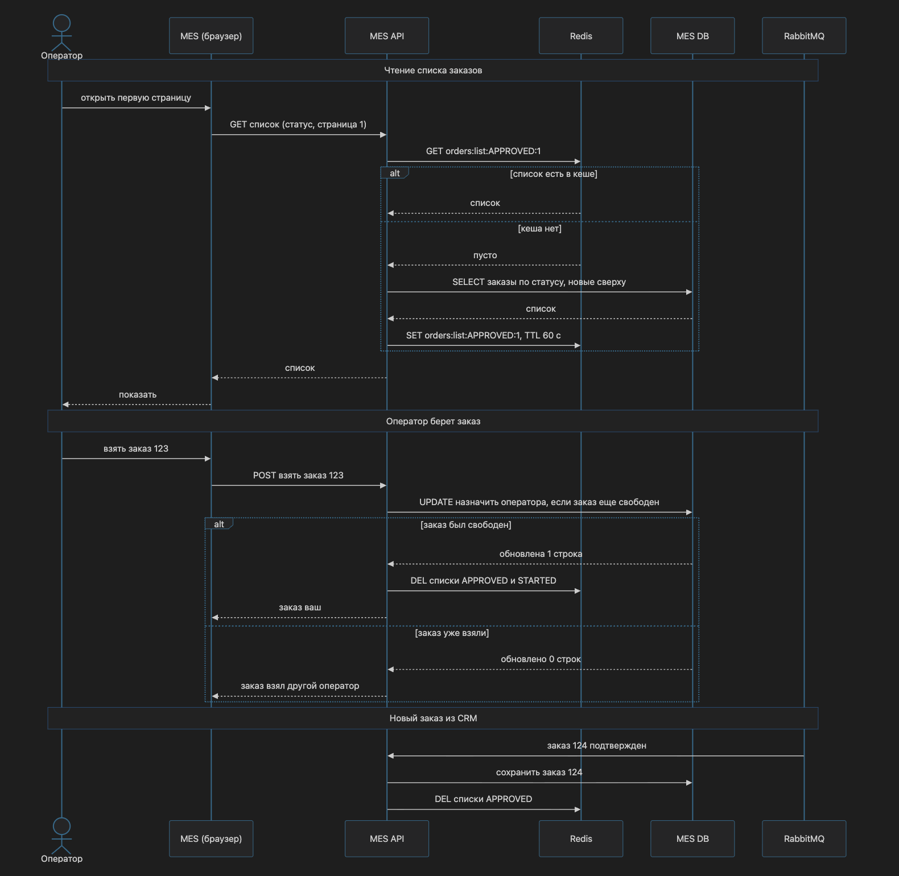

# Архитектурное решение по кешированию

## Мотивация

Операторы жалуются, что первая страница MES — список заказов по статусам — грузится долго. Фильтр и пагинация не помогли. Список обновляют постоянно: вознаграждение зависит от того, кто первым возьмет новый заказ. Таблица заказов растет (+100 заказов каждый месяц), а каждый запрос списка идет в единственный инстанс MES DB, который работает и на чтение, и на запись.

**Кешируем:** список заказов на первой странице MES.

**Что решит:**
- страница операторов открывается быстро
- MES DB не тратится на одинаковые запросы, остается запас на запись статусов

**Что не решит:** долгий расчет цены — это асинхронный API и воркеры из задания 1

## Предлагаемое решение

Серверный кеш — одна копия списка для всех операторов. Статус поменялся — сбрасываем кеш в одном месте, все сразу видят актуальный список

Кеш только для показа списка. Кто взял заказ, решает MES DB одной операцией: заказ свободен — назначаем оператора, уже занят — отвечаем "заказ взял другой оператор". Два оператора не возьмут один заказ даже при устаревшем списке

**Паттерн: Cache-Aside**
- Чтение: есть список в кеше — отдаем. Нет — берем из MES DB, кладем в кеш, отдаем
- Смена статуса: пишем в MES DB и удаляем список из кеша. Следующее чтение соберет свежий
- Плюсы: просто, в кеше только то, что реально читают, сброс при смене статуса — одна команда
- Минус: первое чтение после сброса идет в базу. При сотнях смен статуса против десятков тысяч чтений это немного

**Почему не Write-Through**
- В кеше готовый список по статусам и страницам — смена одного статуса меняет несколько страниц, пересобирать их при каждой записи сложно
- Статус меняют и операторы, и сообщения из CRM — каждый путь записи должен обновлять кеш. Забыли один — список врет

**Почему не Refresh-Ahead**
- Кеш обновляется по таймеру. Петя взял заказ через 2 секунды после обновления — следующие 8 секунд все видят заказ свободным. Для операторов, которые соревнуются за заказы, это плохо
- База пересобирает список по таймеру, даже когда ничего не поменялось

### Диаграмма последовательности

Диаграмма: [sequence_diagram.md](sequence_diagram.md)

### Инвалидация кеша

Статус заказа поменялся (оператор взял заказ, пришел новый заказ из CRM) — код удаляет из кеша списки затронутых статусов. Следующее чтение соберет свежий
TTL 60 секунд — страховка, если сброс не сработал или старый список успели положить обратно. Ошибка живет не дольше минуты
